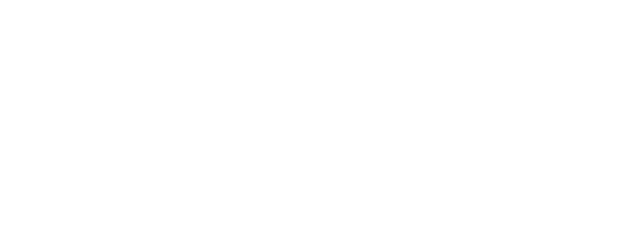
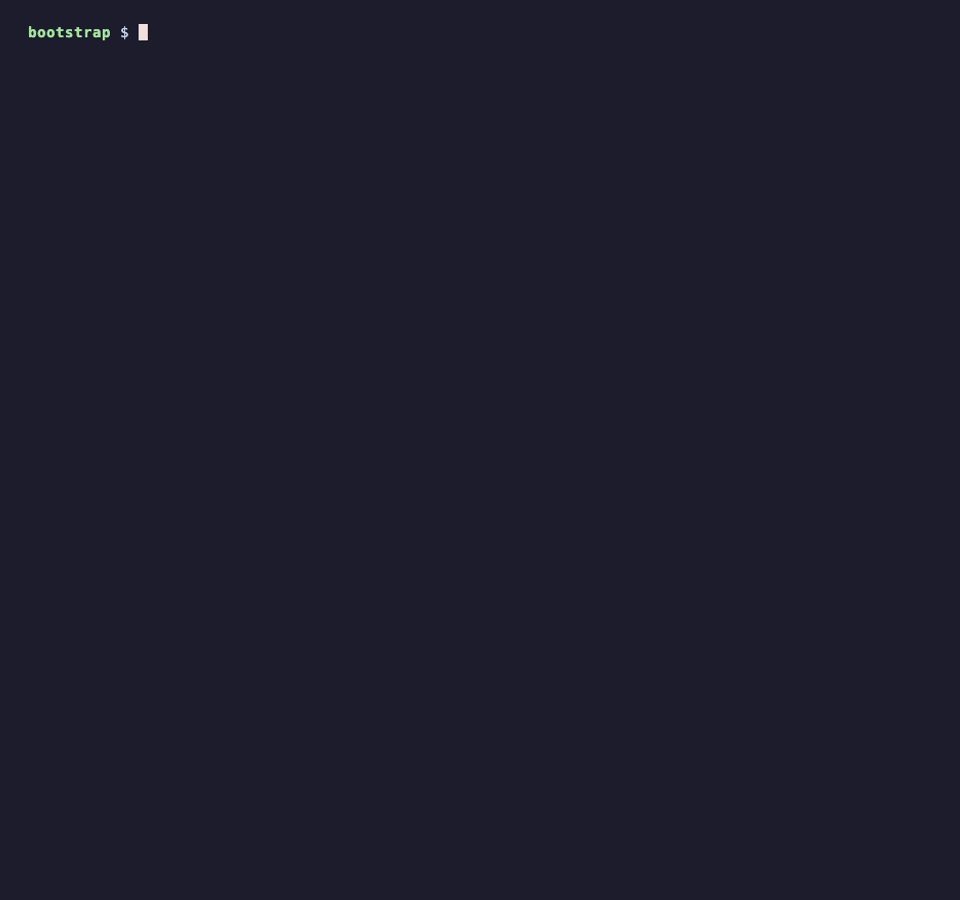

<p align="center">
  
</p>

# stylelint-plugin-rhythmguard

Nobody chose 13px. Rhythmguard catches off-scale spacing in CSS and Tailwind class strings, tells you the nearest steps on your scale, and snaps to them or to your tokens when you ask.

[](https://github.com/petrilahdelma/stylelint-plugin-rhythmguard/actions/workflows/ci.yml)
[](https://www.npmjs.com/package/stylelint-plugin-rhythmguard)
[](https://www.npmjs.com/package/stylelint-plugin-rhythmguard)
[](./LICENSE)

Rhythmguard is scale-aware rather than a blanket ban: values on your scale pass, values off it are reported with the two nearest steps, and tokens are only ever suggested from a map you control. It works on CSS and SCSS declarations through Stylelint and on Tailwind class strings through ESLint or Oxlint, and it ships an audit CLI so you can measure drift and ratchet it down before enforcing anything.

What it is not: it does not check colors or hex values, and the Stylelint rules do not see Tailwind class strings (that is the ESLint plugin below). It reads CSS and SCSS; Less and CSS-in-JS are not read. Pair it with a color linter if you need one; do not expect one tool to do both. Nor does it judge type for reading: whether a measure, a fluid heading or a number column works for the reader is the job of [Measured Type](#type-pair-it-with-measured-type).

## Start here

```bash
npx rhythmguard
```

No install, no config. It detects your stack and token files, infers your spacing scale from your own tokens, audits the current directory, and prints the exact `.stylelintrc.json` (and ESLint snippet for Tailwind) to paste. This is the whole run on Bootstrap's `v6-dev` branch, unedited:

<p align="center">
  
</p>

Then add the linter you already run. Most projects need one; a project with both stylesheets and class strings can run both.

### Stylesheets: Stylelint

```bash
npm install --save-dev stylelint stylelint-plugin-rhythmguard
```

```json
{
  "extends": ["stylelint-plugin-rhythmguard/configs/recommended"]
}
```

That enables `rhythmguard/use-scale` on spacing properties with the default 4px scale. Tailwind projects use the `tailwind` config instead, which also extracts spacing tokens from `@theme`:

```json
{
  "extends": ["stylelint-plugin-rhythmguard/configs/tailwind"]
}
```

### Class strings: ESLint or Oxlint

For Tailwind class strings in JSX, TSX, Vue, Svelte or Astro, use [`eslint-plugin-rhythmguard`](packages/eslint-plugin-rhythmguard#readme). It needs no Stylelint. It is the same rules as `stylelint-plugin-rhythmguard/eslint`, so either import works, and CI tests them under Oxlint's JS plugins too. How it compares with the other Tailwind lint rules: [the comparison](packages/eslint-plugin-rhythmguard#why-this-and-not-a-ban).

```bash
npm install --save-dev eslint eslint-plugin-rhythmguard
```

```js
// eslint.config.js
import rhythmguard from 'eslint-plugin-rhythmguard';

export default [
  {
    files: ['**/*.{js,jsx,mjs,cjs}'],
    languageOptions: { parserOptions: { ecmaFeatures: { jsx: true } } },
    plugins: { 'rhythmguard-tailwind': rhythmguard },
    rules: { 'rhythmguard-tailwind/tailwind-class-use-scale': ['error', { scale: [0, 4, 8, 12, 16, 24, 32] }] },
  },
];
```

`files` and `ecmaFeatures.jsx` are what make ESLint read `.jsx`; without them it lints no JSX at all. TypeScript, Vue, Svelte and Astro files need their parser (`typescript-eslint`, `vue-eslint-parser`, `svelte-eslint-parser`, `astro-eslint-parser`) in a block of their own: see [Other file types](packages/eslint-plugin-rhythmguard#other-file-types).

## Rules

| Rule | What it reports | Fix |
| --- | --- | --- |
| [`rhythmguard/use-scale`](docs/rules/use-scale.md) | Length values off the configured scale | Nearest scale value |
| [`rhythmguard/prefer-token`](docs/rules/prefer-token.md) | Raw literals where a design token exists | Token from your map |
| [`rhythmguard/no-offscale-transform`](docs/rules/no-offscale-transform.md) | Off-scale `translate*` offsets | Nearest scale value |
| [`rhythmguard/use-motion-scale`](docs/rules/use-motion-scale.md) | Off-scale durations and raw easing curves. Opt-in, experimental | Nearest duration |
| [`rhythmguard-tailwind/tailwind-class-use-scale`](docs/rules/tailwind-class-use-scale.md) | Off-scale Tailwind arbitrary spacing values (`p-[13px]`) in class strings | Nearest scale value |
| [`rhythmguard-tailwind/tailwind-class-use-motion-scale`](docs/rules/tailwind-class-use-motion-scale.md) | Off-scale `duration-[...]`, `delay-[...]`, raw `ease-[...]`. Opt-in | Nearest duration |

Every rule validates its options up front. Unknown option names and wrong shapes are reported, never ignored.

## Configs

`recommended`, `strict`, `tailwind`, `motion` (experimental), and `embed` for authors of shared configs (see [docs/FOR_CONFIG_AUTHORS.md](docs/FOR_CONFIG_AUTHORS.md)). All are `stylelint-plugin-rhythmguard/configs/<name>`. What each enables, the full custom setup, and the scale-selection precedence are in [docs/CONFIGS.md](docs/CONFIGS.md). Built-in and community scale presets are in [docs/SCALE_PRESETS.md](docs/SCALE_PRESETS.md).

## Audit before you enforce

With the package installed, the `rhythmguard` command is available to `npx`:

```bash
npx rhythmguard audit ./src --format markdown
npx rhythmguard audit ./src --write-baseline
npx rhythmguard audit ./src --since-baseline --fail-on-new-drift
npx rhythmguard audit ./src --format github
```

The audit scans CSS declarations, Tailwind class strings and your token contract, prints a scale-cleanliness score, and supports baselines so legacy codebases can gate only new drift. Formats: text, Markdown, JSON 2.0, HTML, GitHub Actions annotations, and a shields.io badge document for your README. Full reference in [docs/AUDIT.md](docs/AUDIT.md), rollout recipe and the badge workflow in [docs/CI_ADOPTION.md](docs/CI_ADOPTION.md). In GitHub Actions, [`PetriLahdelma/rhythmguard-action@v1`](https://github.com/PetriLahdelma/rhythmguard-action) runs the audit, annotates the diff, comments on the pull request and fails on new drift in one step.

`npx rhythmguard audit ./src --plan` turns the report into a proposed `decisions` section (adopt a value, allow it, or snap it), and `npx rhythmguard fix ./src --value 10px --to "var(--space-sm)" --write` executes one decision as one reviewable change; see [decisions](docs/AUDIT.md#decisions). `npx rhythmguard init` writes a starter config for your stack, and `init --agents all` installs the coding-agent instructions. `npx rhythmguard doctor` checks the setup.

## Guides

- [Tailwind integration](docs/TAILWIND.md), including v4 `@theme` tokens and what each layer covers
- [Framework setup](docs/FRAMEWORKS.md) for Vue, Lit, Astro and SvelteKit
- [Comparison with adjacent plugins](docs/COMPARISON.md) and migration recipes
- [Real before/after excerpts](docs/ADOPTION_DIFFS.md) from public codebases
- [For shared-config authors](docs/FOR_CONFIG_AUTHORS.md): the `embed` entry point and how inference works per consumer
- [For coding agents](docs/FOR_AGENTS.md): a paste-ready `AGENTS.md` block, installable with `npx rhythmguard init --agents all` for Claude Code, Cursor and Copilot
- [Quiet benchmark](docs/QUIET_BENCHMARK.md): findings on public design systems, checked on every change
- [State of Spacing](docs/STATE_OF_SPACING.md): dated editions of the same data, ranked by drift density, with the values and properties that drifted
- [Agent evals](docs/AGENT_EVALS.md): does a finding get a coding agent to zero drift, in how many rounds, at what cost, against a rules-only control. First edition (2026-10-10): every model fixed every finding in one round with or without the findings; fixing from findings cost Sonnet 5 less than half as much
- [Architecture](docs/ARCHITECTURE.md): the layers, the rule kit, the invariants and where each is enforced
- [Roadmap](ROADMAP.md): what is planned from October 2026 to June 2027, and the checkpoint that decides the pace
- [Product analysis, September 2026](docs/STRATEGY_2026-09.md): the market data behind the roadmap
- Browser playground: [petrilahdelma.github.io/stylelint-plugin-rhythmguard](https://petrilahdelma.github.io/stylelint-plugin-rhythmguard/) runs the real rules, bundled for the browser, on CSS or SCSS you paste; `scale: "auto"`, tokens and fixes included, and a test proves it reports what Stylelint reports

## Type: pair it with Measured Type

Rhythmguard keeps every value on the scale; it does not decide whether the scale reads well. [Measured Type](https://github.com/PetriLahdelma/measured-type), a coding-agent skill by the same author, does that part: Bringhurst's rules applied to CSS, with line length, zoom, contrast, tabular figures and font features measured in a real browser. Let it build the type scale and Rhythmguard hold everyone to it:

```bash
node scripts/type-scale.js --base 1rem:1.125rem --ratio 1.2:1.25 --steps 5 --fluid-from 4 --prefix font-size
```

That writes `--font-size-*` tokens, which the `typography` group reads with `"auto"`. Add your label and caption sizes to the same file, then list it next to your spacing tokens:

```json
"rhythmguard/use-scale": [true, {
  "propertyGroups": ["spacing", "typography"],
  "scale": "auto",
  "scaleSources": ["src/space.css", "src/type.css"],
  "scales": { "typography": "auto" }
}]
```

The two do not overlap. Rhythmguard reports the `13px` padding and the `17px` heading nobody chose; Measured Type reports the `3vw` size that cannot grow with zoom (Rhythmguard skips viewport units by design) and the `66ch` measure that sets 81 characters per line in Verdana. The worked example, run with Stylelint 17.16 and Rhythmguard 3.14.0, is in [Measured Type's README](https://github.com/PetriLahdelma/measured-type#pairs-with-rhythmguard).

## Compatibility

Stylelint 16.7 to 18. The floor is 16.7.0 because Stylelint reads a rule's fix callback from that version on; on 16.0 to 16.6 `--fix` changed nothing. Node 20.19 or newer; Node 20 itself is end of life, and 4.0 raises the floor to 22.22 ([#172](https://github.com/PetriLahdelma/stylelint-plugin-rhythmguard/issues/172)). Stylelint 18 needs Node 22.22, 24.15 or 26, and on an older Node npm installs Stylelint 17 for `npx rhythmguard`. The ESLint companion needs ESLint 8 or newer, is tested on ESLint 9 and 10, and is tested in CI on Oxlint 1.88.0. Three runtime dependencies (`known-css-properties`, `postcss`, `postcss-value-parser`); `stylelint` is a peer you need only for the Stylelint rules and the stylesheet audit, so an ESLint-only project installs without it, and `npx rhythmguard` brings its own; `postcss-scss`, `stylelint-config-tailwindcss` and `stylelint-plugin-logical-css` are optional peers (`stylelint-plugin-logical-css` itself still peers on Stylelint 17 or older). CommonJS and ESM entry points, TypeScript declarations for every export. The CI matrix runs Node 20 and 22 against Stylelint 16.7.0, 16.x and 17.x, and Node 22, 24 and 26 against 18.x; a weekly job runs the suite against the latest Stylelint. Upgrading from 2.x: [docs/MIGRATING_TO_3.md](docs/MIGRATING_TO_3.md).

### Stylelint 18's custom-property rule

Stylelint 18 added `value-type-custom-property-required-list`. It answers a different question from `use-scale`. The core rule says a length must be a custom property: it reports `16px` and a `1px` hairline the same way as `13px`, names no step, and `--fix` leaves the value alone. `use-scale` says which value is off your scale and which two steps are nearest, and `--fix` writes the nearest step; `prefer-token` names the token that holds the value; both read the scale from your token file. To move every length to a token over time, run both:

```json
{
  "plugins": ["stylelint-plugin-rhythmguard"],
  "rules": {
    "rhythmguard/use-scale": [true, { "scale": "auto" }],
    "value-type-custom-property-required-list": [["length"], { "severity": "warning" }]
  }
}
```

## Contributing and support

Questions and ideas: [Discussions](https://github.com/PetriLahdelma/stylelint-plugin-rhythmguard/discussions). Bugs and false positives: [GitHub issues](https://github.com/PetriLahdelma/stylelint-plugin-rhythmguard/issues). Want to help? Issues labelled [good first issue](https://github.com/PetriLahdelma/stylelint-plugin-rhythmguard/labels/good%20first%20issue) name the files to touch and how to know you are done, and [CONTRIBUTING.md](CONTRIBUTING.md) gets you from clone (or a [Codespace](https://codespaces.new/PetriLahdelma/stylelint-plugin-rhythmguard)) to a passing `npm run check`. Development setup, semver policy, the feature freeze until 4.0 and the release process are there too. Security: see [SECURITY.md](SECURITY.md).

## License

MIT. See [LICENSE](./LICENSE).
