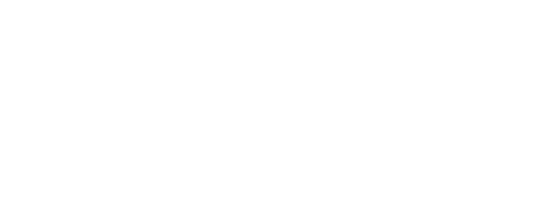
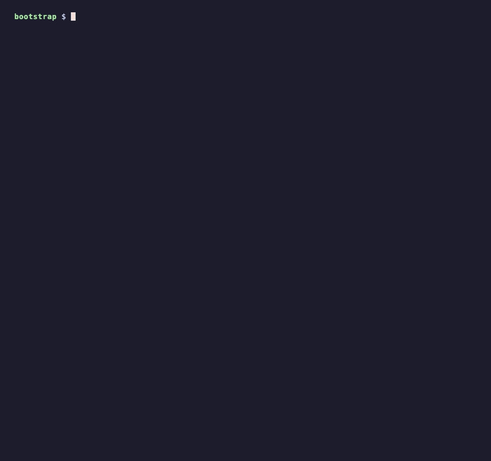

<p align="center">
  
</p>

# stylelint-plugin-rhythmguard

Nobody chose 13px; Rhythmguard reads the spacing scale from your design tokens, reports off-scale spacing in CSS, SCSS and Tailwind class strings with the two nearest steps, and fails CI only on new drift.

[](https://github.com/petrilahdelma/stylelint-plugin-rhythmguard/actions/workflows/ci.yml)
[](https://www.npmjs.com/package/stylelint-plugin-rhythmguard)
[](https://www.npmjs.com/package/stylelint-plugin-rhythmguard)
[](./LICENSE)

Checked against: the spacing tokens of 16 design-token packages, read directly (Bootstrap, Carbon, Primer, PatternFly, GOV.UK Frontend, NHS.UK Frontend, Mozilla Protocol, WordPress, Wikimedia Codex, Radix Themes, Mantine, Polaris, Spectrum, mittwald Flow and Tailwind), and 57 public repositories, design systems and the apps built on them, pinned by commit and measured again whenever the rules or the scale inference change ([quiet benchmark](docs/QUIET_BENCHMARK.md)).

## Start here

```bash
npx rhythmguard
```

No install, no config, and it writes no file. It detects your stack and token files, infers your spacing scale from your own tokens, audits the current directory, and prints the exact config to paste, with the `.rhythmguardrc.json` that makes a bare `npx rhythmguard audit .` use the same scale. This is the whole run on Bootstrap's `v6-dev` branch, unedited:

<p align="center">
  
</p>

Then pick the door that describes you.

### Your scale lives in a token file

Rhythmguard reads the scale from the file your design system already ships: DTCG JSON (including 2025.10 dimension objects and `$root` tokens), Style Dictionary JSON, Tokens Studio exports, flat JSON, CSS custom properties, Tailwind v4 `@theme`, and Sass variables and maps. It also reads the 16 token packages above when they are installed. Spacing written as multiples of a unit with no fixed length (`--gap: calc(1rlh - 1rex)` with `calc(var(--gap) * 2)`) is checked as a ladder of multipliers with `unitLadder` on `use-scale` and `rhythmguard audit --unit-ladder` ([unit ladders](docs/rules/use-scale.md#unit-ladders)). Figma variables exports are not read. Name the file once in `.rhythmguardrc.json`; `scale: "auto"` in the Stylelint rules and `npx rhythmguard audit` then use the same scale:

```json
{
  "audit": {
    "scale": "auto",
    "tokenSources": ["./tokens/spacing.tokens.json"]
  }
}
```

```json
{
  "extends": ["stylelint-plugin-rhythmguard/configs/recommended"],
  "rules": {
    "rhythmguard/use-scale": [true, { "scale": "auto" }]
  }
}
```

`npx rhythmguard scale` prints the scale, the file it came from and the token that holds each step. In the audit, `prefer-token` names that token and its file (`Use var(--space-3) (tokens/tokens.json).`), and `--report-missing-tokens` reports a `var()` of a token that nothing defines. The ESLint rule for class strings takes the steps as a `scale` array; copy them from `npx rhythmguard scale`. More for design-system teams: [shared configs and the `embed` entry point](docs/FOR_CONFIG_AUTHORS.md), [token sources in the audit](docs/AUDIT.md#config-file), [scale presets](docs/SCALE_PRESETS.md).

### You write CSS or Tailwind in a product repo

Your scale might be a 4px grid, an 8pt grid, Tailwind's ladder or steps your team picked. Add the linter you already run. Most projects need one; a project with both stylesheets and class strings can run both.

#### Stylesheets: Stylelint

```bash
npm install --save-dev stylelint stylelint-plugin-rhythmguard
```

```json
{
  "extends": ["stylelint-plugin-rhythmguard/configs/recommended"]
}
```

That enables `rhythmguard/use-scale` on spacing properties with the default scale (`0, 4, 8, 12, 16, 24, 32, 40, 48, 64`). Tailwind projects use the `tailwind` config instead, which reads spacing tokens from `@theme` and falls back to Tailwind's default ladder:

```json
{
  "extends": ["stylelint-plugin-rhythmguard/configs/tailwind"]
}
```

#### Class strings: ESLint or Oxlint

For Tailwind class strings in JSX, TSX, Vue, Svelte or Astro, use [`eslint-plugin-rhythmguard`](packages/eslint-plugin-rhythmguard#readme). It needs no Stylelint. It is the same rules as `stylelint-plugin-rhythmguard/eslint`, so either import works. How it compares with the other Tailwind lint rules: [the comparison](docs/COMPARISON.md).

```bash
npm install --save-dev eslint eslint-plugin-rhythmguard
```

```js
// eslint.config.js
import rhythmguard from 'eslint-plugin-rhythmguard';

export default [
  {
    files: ['**/*.{js,jsx,mjs,cjs}'],
    languageOptions: { parserOptions: { ecmaFeatures: { jsx: true } } },
    plugins: { 'rhythmguard-tailwind': rhythmguard },
    rules: { 'rhythmguard-tailwind/tailwind-class-use-scale': ['error', { scale: [0, 4, 8, 12, 16, 24, 32] }] },
  },
];
```

`files` and `ecmaFeatures.jsx` are what make ESLint read `.jsx`; without them it lints no JSX at all. TypeScript, Vue, Svelte and Astro files need their parser (`typescript-eslint`, `vue-eslint-parser`, `svelte-eslint-parser`, `astro-eslint-parser`) in a block of their own: see [Other file types](packages/eslint-plugin-rhythmguard#other-file-types). The rule checks bracketed values such as `p-[13px]`; a bare step such as `p-3.25` is not checked.

The same rules run under Oxlint as a JS plugin ([config](packages/eslint-plugin-rhythmguard#oxlint)). Oxlint's JS plugins are alpha, and in Vue, Svelte and Astro files Oxlint lints only the `<script>` blocks, so class strings in templates are not checked there; keep ESLint for those files. CI tests the rules on Oxlint 1.93.0.

### An agent writes your CSS

Give your coding agent this prompt: "Read https://github.com/PetriLahdelma/stylelint-plugin-rhythmguard/blob/main/docs/SETUP.md and set up Rhythmguard in this project."

Install the agent skill: `npx skills add PetriLahdelma/stylelint-plugin-rhythmguard --skill rhythmguard`, or in Claude Code `/plugin marketplace add PetriLahdelma/stylelint-plugin-rhythmguard` then `/plugin install rhythmguard@rhythmguard`.

[docs/SETUP.md](docs/SETUP.md) is the setup written for the agent to execute; [docs/FOR_AGENTS.md](docs/FOR_AGENTS.md) has the block to paste into `AGENTS.md`, and `npx rhythmguard init --agents all` installs the instruction packs. The agent reads findings from `npx rhythmguard audit . --scale auto --format json`; each one names the value, its file and line, and the two nearest steps.

## In CI

Record today's drift once, then fail only on what a change adds:

```bash
npx rhythmguard audit ./src --write-baseline
npx rhythmguard audit ./src --since-baseline --fail-on-new-drift
```

In GitHub Actions, [`PetriLahdelma/rhythmguard-action@v1`](https://github.com/PetriLahdelma/rhythmguard-action) runs the audit, annotates the diff, comments on the pull request and fails on new drift in one step. Token debt (a raw value a token could replace) stays in the report and fails the gate only with `--fail-on-new-token-debt`. `--format markdown` writes a pull-request report, `--format github` writes annotations, and a shields.io badge document puts the score in your README. Full reference in [docs/AUDIT.md](docs/AUDIT.md); the rollout recipe and the badge workflow are in [docs/CI_ADOPTION.md](docs/CI_ADOPTION.md). ESLint-only projects can use ESLint's bulk suppressions instead of a baseline file: [Adopting it on an existing codebase](packages/eslint-plugin-rhythmguard#adopting-it-on-an-existing-codebase).

## In your editor

Rhythmguard has no editor extension of its own. Findings appear through the linter extensions you already run, in VS Code and in Cursor, which installs the same extensions:

- **Stylelint** (`stylelint.vscode-stylelint`) uses the project's Stylelint and config. It checks only `css` and `postcss` files by default, so SCSS shows nothing until you add it to `stylelint.validate` in `.vscode/settings.json`. Add `vue`, `svelte` or `astro` once your Stylelint config reads those files ([Framework setup](docs/FRAMEWORKS.md)).
- **ESLint** (`dbaeumer.vscode-eslint`) checks JavaScript, TypeScript, JSX, Vue and Astro by default. Svelte needs `eslint.validate`; a language list there replaces the defaults, so list every language you lint.
- **Oxlint**: the Oxc extension (`oxc.oxc-vscode`) runs Oxlint in VS Code and Cursor. CI tests Rhythmguard through the `oxlint` command; the extension with Rhythmguard's JS plugin is untested.

```json
{
  "stylelint.validate": ["css", "postcss", "scss"],
  "eslint.validate": ["javascript", "javascriptreact", "typescript", "typescriptreact", "vue", "svelte", "astro"]
}
```

A finding reads the same in the editor as on the command line, and links to its rule page: `Unexpected off-scale value "13px". Use scale values (nearest: 12px or 16px).` Fix on save (`source.fixAll.stylelint` or `source.fixAll.eslint` in `editor.codeActionsOnSave`) applies Rhythmguard's fixes too, so read the next section before you turn it on.

## Fixing, last and opt-in

The quickstart, `audit` and `--plan` never change a stylesheet or a component; they print. Until 4.0 labels each fix by whether it keeps the rendered output, one rule holds: fixes can move layout; run `--plan` first.

```bash
npx rhythmguard audit ./src --plan
npx rhythmguard fix ./src --value 10px --to "var(--space-sm)"
npx rhythmguard fix ./src --value 10px --to "var(--space-sm)" --write
```

`--plan` turns the report into a proposed `decisions` section: adopt a value onto the scale, allow it, or snap it. `fix` executes one decision as one reviewable change; it is a dry run that lists every line it would change until you add `--write`. See [decisions](docs/AUDIT.md#decisions). `stylelint --fix` and `eslint --fix` write the nearest step wherever a rule has a fix, all at once; `fixToScale: false` on `use-scale` and `no-offscale-transform` keeps the findings and drops that fix.

## Rules

| Rule | What it reports | Fix |
| --- | --- | --- |
| [`rhythmguard/use-scale`](docs/rules/use-scale.md) | Length values off the configured scale | Nearest scale value |
| [`rhythmguard/prefer-token`](docs/rules/prefer-token.md) | Raw literals where a design token exists | Token from your map |
| [`rhythmguard/no-offscale-transform`](docs/rules/no-offscale-transform.md) | Off-scale `translate*` offsets | Nearest scale value |
| [`rhythmguard/use-motion-scale`](docs/rules/use-motion-scale.md) | Off-scale durations and raw easing curves. Opt-in, experimental | Nearest duration |
| [`rhythmguard-tailwind/tailwind-class-use-scale`](docs/rules/tailwind-class-use-scale.md) | Off-scale Tailwind arbitrary spacing values (`p-[13px]`) in class strings | Nearest scale value |
| [`rhythmguard-tailwind/tailwind-class-use-motion-scale`](docs/rules/tailwind-class-use-motion-scale.md) | Off-scale `duration-[...]`, `delay-[...]`, raw `ease-[...]`. Opt-in | Nearest duration |

Every rule validates its options up front. Unknown option names and wrong shapes are reported, never ignored.

## Configs

`recommended`, `strict`, `tailwind`, `motion` (experimental), and `embed` for authors of shared configs (see [docs/FOR_CONFIG_AUTHORS.md](docs/FOR_CONFIG_AUTHORS.md)). All are `stylelint-plugin-rhythmguard/configs/<name>`. What each enables, the full custom setup, and the scale-selection precedence are in [docs/CONFIGS.md](docs/CONFIGS.md). Built-in and community scale presets are in [docs/SCALE_PRESETS.md](docs/SCALE_PRESETS.md).

## What it does not do

It does not check colors or hex values, and the Stylelint rules do not see Tailwind class strings (the ESLint plugin does). It reads CSS and SCSS; Less and CSS-in-JS are not read, and the audit does not read component `<style>` blocks. In class strings it checks bracketed values (`p-[13px]`); a bare Tailwind v4 step such as `p-3.25` passes, as it does in every tool in [the comparison](docs/COMPARISON.md). Pair it with a color linter if you need one. Nor does it judge type for reading: whether a measure, a fluid heading or a number column works for the reader is the job of [Measured Type](#type-pair-it-with-measured-type).

## Guides

- [Tailwind integration](docs/TAILWIND.md), including v4 `@theme` tokens, what each layer covers, and running it next to @shadcn/lint and Tailwind's canonical classes
- [Framework setup](docs/FRAMEWORKS.md) for Vue, Lit, Astro and SvelteKit
- [The tool you already have, and what Rhythmguard adds](docs/COMPARISON.md): Stylelint 18's core rules, stylelint-declaration-strict-value, stylelint-scales, the Tailwind lint plugins, oxlint-tailwindcss and token-file linters
- [For shared-config authors](docs/FOR_CONFIG_AUTHORS.md): the `embed` entry point and how inference works per consumer
- [For coding agents](docs/FOR_AGENTS.md): a paste-ready `AGENTS.md` block, installable with `npx rhythmguard init --agents all` for Claude Code, Cursor and Copilot
- [Quiet benchmark](docs/QUIET_BENCHMARK.md): findings on public design systems, checked against pinned commits
- [State of Spacing](docs/STATE_OF_SPACING.md): dated editions of the same data, ranked by drift density, with the values and properties that drifted
- [Agent evals](docs/AGENT_EVALS.md): does a finding get a coding agent to zero drift, in how many rounds, at what cost, against a rules-only control. First edition (2026-10-10): every model fixed every finding in one round with or without the findings; fixing from findings cost Sonnet 5 less than half as much
- [Before/after excerpts](docs/ADOPTION_DIFFS.md) from the author's own sites
- Browser playground: [petrilahdelma.github.io/stylelint-plugin-rhythmguard](https://petrilahdelma.github.io/stylelint-plugin-rhythmguard/) runs the real rules, bundled for the browser, on CSS or SCSS you paste; `scale: "auto"`, tokens and fixes included, and a test proves it reports what Stylelint reports
- Project: [Architecture](docs/ARCHITECTURE.md), [Roadmap](ROADMAP.md), [Product analysis, September 2026](docs/STRATEGY_2026-09.md)

## Seen in the wild

Public links only. None of these projects endorses Rhythmguard.

- Materialize merged [#670](https://github.com/materializecss/materialize/pull/670) on 2026-10-12: its spacing scale as CSS variables, with six declarations snapped onto it, after an audit issue ([#665](https://github.com/materializecss/materialize/issues/665)). Rhythmguard's author opened the pull request at the maintainer's request.
- Maintainers and contributors said in public issues where their spacing scale lives, and `scale: "auto"` reads those packages: WordPress Gutenberg ([#82502](https://github.com/WordPress/gutenberg/issues/82502)), NHS.UK Frontend ([#2085](https://github.com/nhsuk/nhsuk-frontend/issues/2085)), PatternFly ([#8579](https://github.com/patternfly/patternfly/issues/8579)), Primer ([#3166](https://github.com/primer/css/issues/3166)), mittwald Flow ([#3129](https://github.com/mittwald/flow/issues/3129)) and Mozilla Protocol ([#1132](https://github.com/mozilla/protocol/issues/1132)).

## Type: pair it with Measured Type

Rhythmguard keeps every value on the scale; it does not decide whether the scale reads well. [Measured Type](https://github.com/PetriLahdelma/measured-type), a coding-agent skill by the same author, does that part: Bringhurst's rules applied to CSS, with line length, zoom, contrast, tabular figures and font features measured in a real browser. Let it build the type scale and Rhythmguard hold everyone to it:

```bash
node scripts/type-scale.js --base 1rem:1.125rem --ratio 1.2:1.25 --steps 5 --fluid-from 4 --prefix font-size
```

That writes `--font-size-*` tokens, which the `typography` group reads with `"auto"`. Add your label and caption sizes to the same file, then list it next to your spacing tokens:

```json
"rhythmguard/use-scale": [true, {
  "propertyGroups": ["spacing", "typography"],
  "scale": "auto",
  "scaleSources": ["src/space.css", "src/type.css"],
  "scales": { "typography": "auto" }
}]
```

The two do not overlap. Rhythmguard reports the `13px` padding and the `17px` heading nobody chose; Measured Type reports the `3vw` size that cannot grow with zoom (Rhythmguard skips viewport units by design) and the `66ch` measure that sets 81 characters per line in Verdana. The worked example, run with Stylelint 17.16 and Rhythmguard 3.14.0, is in [Measured Type's README](https://github.com/PetriLahdelma/measured-type#pairs-with-rhythmguard).

## Compatibility

Stylelint 16.7 to 18. The floor is 16.7.0 because Stylelint reads a rule's fix callback from that version on; on 16.0 to 16.6 `--fix` changed nothing. Node 20.19 or newer; Node 20 itself is end of life, and 4.0 raises the floor to 22.22 ([#172](https://github.com/PetriLahdelma/stylelint-plugin-rhythmguard/issues/172)). Stylelint 18 needs Node 22.22, 24.15 or 26, and on an older Node npm installs Stylelint 17 for `npx rhythmguard`. The ESLint companion needs ESLint 8 or newer, is tested on ESLint 9 and 10, and is tested in CI on Oxlint 1.93.0, whose JS plugins are alpha; in Vue, Svelte and Astro files Oxlint lints only the `<script>` blocks. Three runtime dependencies (`known-css-properties`, `postcss`, `postcss-value-parser`); `stylelint` is a peer you need only for the Stylelint rules and the stylesheet audit, so an ESLint-only project installs without it, and `npx rhythmguard` brings its own; `postcss-scss`, `stylelint-config-tailwindcss` and `stylelint-plugin-logical-css` are optional peers (`stylelint-plugin-logical-css` itself still peers on Stylelint 17 or older). CommonJS and ESM entry points, TypeScript declarations for every export. The CI matrix runs Node 22 against Stylelint 16.7.0, 16.x, 17.x and 18.x, Node 24 and 26 against 18.x, and Node 20 against 17.x; a weekly job runs the suite against the newest Stylelint, ESLint and Oxlint. Upgrading from 2.x: [docs/MIGRATING_TO_3.md](docs/MIGRATING_TO_3.md).

### Stylelint 18's custom-property rule

Stylelint 18 added `value-type-custom-property-required-list`. It answers a different question from `use-scale`. The core rule says a length must be a custom property: it reports `16px` and a `1px` hairline the same way as `13px`, names no step, and `--fix` leaves the value alone. `use-scale` says which value is off your scale and which two steps are nearest, and `--fix` writes the nearest step; `prefer-token` names the token that holds the value; both read the scale from your token file. To move every length to a token over time, run both:

```json
{
  "plugins": ["stylelint-plugin-rhythmguard"],
  "rules": {
    "rhythmguard/use-scale": [true, { "scale": "auto" }],
    "value-type-custom-property-required-list": [["length"], { "severity": "warning" }]
  }
}
```

## Contributing and support

Questions and ideas: [Discussions](https://github.com/PetriLahdelma/stylelint-plugin-rhythmguard/discussions). Bugs and false positives: [GitHub issues](https://github.com/PetriLahdelma/stylelint-plugin-rhythmguard/issues). Want to help? Issues labelled [good first issue](https://github.com/PetriLahdelma/stylelint-plugin-rhythmguard/labels/good%20first%20issue) name the files to touch and how to know you are done, and [CONTRIBUTING.md](CONTRIBUTING.md) gets you from clone (or a [Codespace](https://codespaces.new/PetriLahdelma/stylelint-plugin-rhythmguard)) to a passing `npm run check`. Development setup, semver policy, the feature freeze until 4.0 and the release process are there too. Security: see [SECURITY.md](SECURITY.md).

## License

MIT. See [LICENSE](./LICENSE).
