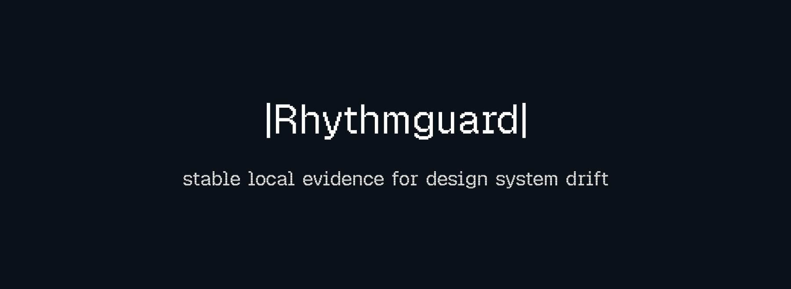

<p align="center">
  
</p>

# eslint-plugin-rhythmguard

Nobody chose 13px; Rhythmguard reads the spacing scale from your design tokens, reports off-scale spacing in CSS, SCSS and Tailwind class strings with the two nearest steps, and fails CI only on new drift.

This package is the class-string half, for ESLint and Oxlint. It catches off-scale Tailwind arbitrary spacing in class strings, and points at each class with the utility classes for the two nearest steps on your scale, offered as one-click suggestions in your editor; `--fix` writes a class only when it renders the same value. It reads your scale from the same token files as [stylelint-plugin-rhythmguard](https://www.npmjs.com/package/stylelint-plugin-rhythmguard) and its audit (DTCG, Style Dictionary, Tailwind `@theme`, Sass), or checks the `scale` you set, or Tailwind's default ladder.

[](https://www.npmjs.com/package/eslint-plugin-rhythmguard)
[](https://www.npmjs.com/package/eslint-plugin-rhythmguard)
[](https://github.com/PetriLahdelma/stylelint-plugin-rhythmguard/blob/main/LICENSE)

```tsx
<div className="p-[13px] md:gap-[18px]" />
```

```
1:17  warning  Unexpected Tailwind arbitrary spacing value "p-[13px]". Use "p-3" (12px) or "p-4" (16px)
1:26  warning  Unexpected Tailwind arbitrary spacing value "md:gap-[18px]". Use "gap-4" (16px) or "gap-6" (24px)
```

Each finding underlines its own class and carries both classes as suggestions (`p-3` or `p-4`, the nearest first). Either one changes the rendered padding, so `--fix` leaves the choice to you; `fixOffScale: "nearest"` makes `--fix` write the nearest step (`p-3`, `md:gap-4`), as 3.20 did. Variants, negative signs and important markers are kept: `md:-m-[13px]!` becomes `md:-m-3!`.

## Why this and not a ban

Most Tailwind lint rules either forbid arbitrary values outright or rewrite them to an equivalent class, and an equivalent of 13px is still 13px. This rule asks a different question: is the value one of the steps your design system allows? `p-[12px]` passes on a 4px scale, `p-[13px]` does not, and the finding names the two classes you probably meant.

The same TSX file through each tool, default Tailwind theme, scale `[0, 4, 8, 12, 16, 24, 32]` for Rhythmguard:

| Class | better-tailwindcss 4.10.0 | eslint-plugin-tailwindcss 4.4.0 | @shadcn/lint 0.2.5 | oxlint-tailwindcss 1.17.1 | Rhythmguard |
| --- | --- | --- | --- | --- | --- |
| `p-[13px]` | no finding | no finding | Use `p-3.25` "(same value, on the scale)" | Closest in your theme: `p-3` (12px) or `p-3.5` (14px) | Use `p-3` (12px) or `p-4` (16px) |
| `p-[0.8125rem]` | Simplify to `p-3.25` | Write as `p-3.25` | Use a theme token or scale value | Closest in your theme: `p-3` or `p-3.5` | Use `p-3` (12px) or `p-4` (16px) |
| `p-[12px]` | no finding | Use `p-3` | Use `p-3` | Same value as `p-3` | no finding (on the scale) |
| `p-3.25` | no finding | no finding | no finding | no finding | no finding |

oxlint-tailwindcss runs under Oxlint 1.93.0 with `no-arbitrary-value`, `prefer-scale-token`, `no-unnecessary-arbitrary-value` and `enforce-canonical` on. It offers the nearest steps of your Tailwind theme (`p-3` or `p-3.5` for 13px); Rhythmguard offers the nearest steps of the scale you set.

The last row is the gap every tool shares, this one included: Tailwind v4 accepts any quarter step as a plain class, and nothing checks `p-3.25` against a scale. Rhythmguard catches the value before it is rewritten. Rerun the comparison with `node scripts/bench/tailwind-compare.mjs` in the repository; [full table](https://github.com/PetriLahdelma/stylelint-plugin-rhythmguard/blob/main/benchmarks/tailwind-compare/RESULTS.md).

## Install

```bash
npm install --save-dev eslint eslint-plugin-rhythmguard
```

You do not need Stylelint. The plugin adds 8 packages to an ESLint install and no peer warnings; 3.15.0 also pulled in Stylelint, 101 packages. The `rhythmguard audit` command needs it only for stylesheets: in a project without Stylelint it audits your class strings, lists the stylesheets it could not read with `npm install --save-dev stylelint`, and fails any gate flag (`--max-findings`, `--min-cleanliness`, `--fail-on-new-drift`) rather than pass on a partial read.

## Configure

```js
// eslint.config.js
import rhythmguard from 'eslint-plugin-rhythmguard';

export default [
  {
    files: ['**/*.{js,jsx,mjs,cjs}'],
    languageOptions: { parserOptions: { ecmaFeatures: { jsx: true } } },
    plugins: { 'rhythmguard-tailwind': rhythmguard },
    rules: {
      'rhythmguard-tailwind/tailwind-class-use-scale': ['error', { scale: [0, 4, 8, 12, 16, 24, 32] }],
    },
  },
];
```

`files` and `ecmaFeatures.jsx` are what make ESLint lint `.jsx`: without them a flat config lints only `.js`, `.mjs` and `.cjs`, and JSX is a parsing error.

Or start from the `recommended` config, which turns the spacing rule on as a warning with the default scale:

```js
import rhythmguard from 'eslint-plugin-rhythmguard';

export default [
  {
    files: ['**/*.{js,jsx,mjs,cjs}'],
    languageOptions: { parserOptions: { ecmaFeatures: { jsx: true } } },
    plugins: { 'rhythmguard-tailwind': rhythmguard },
    rules: rhythmguard.configs.recommended.rules,
  },
];
```

`configs.recommended` also registers the plugin, so it works as a config object of its own: `export default [rhythmguard.configs.recommended]` lints `.js`, `.mjs` and `.cjs`, and `{ ...rhythmguard.configs.recommended, files: ['**/*.{js,jsx,mjs,cjs}'], languageOptions: { parserOptions: { ecmaFeatures: { jsx: true } } } }` adds JSX.

### Other file types

Espree, ESLint's default parser, reads JavaScript and JSX only. Other files need their parser in `languageOptions.parser`, in a config block whose `files` matches them, with the plugin and rule added to that block:

- TypeScript (`.ts`, `.tsx`): `typescript-eslint`, with `parser: tseslint.parser` and `files: ['**/*.{ts,tsx}']`. JSX in `.tsx` needs no `ecmaFeatures` there.
- Vue: `vue-eslint-parser`, usually through `eslint-plugin-vue`'s flat configs. The rule checks static `class` attributes in `<template>`, the strings in bound classes (`:class="{ 'p-[13px]': on }"`), and class strings in `<script>` (see [What gets checked](#what-gets-checked)).
- Svelte: `svelte-eslint-parser`, usually through `eslint-plugin-svelte`'s flat configs. The rule checks the static text of `class` attributes (`class="p-[13px] {extra}"`), the strings in `class={...}`, and class strings in `<script>`.
- Astro: `astro-eslint-parser`, usually through `eslint-plugin-astro`'s flat configs.

### Your project's scale

The rule reads the scale you already declare, without running your code: token files (`scaleSources`: CSS, SCSS, DTCG, Style Dictionary, Tokens Studio), your Tailwind v4 CSS entry (`tailwindCss`: `@theme` `--spacing` and `--spacing-*`), or both with `scale: "auto"`, which also reads the nearest `.rhythmguardrc.json`:

```js
rules: {
  'rhythmguard-tailwind/tailwind-class-use-scale': ['error', {
    scale: 'auto',
    scaleSources: ['tokens/spacing.json'],
    tailwindCss: './src/app.css',
  }],
},
```

`--spacing` in the entry sets the spacing unit, and a `--spacing-md: 16px` theme token is named in the message and written by suggestions (`In your theme: "py-md" (16px).`). The `adopt` and `allow` decisions in `.rhythmguardrc.json` hold here as in Stylelint and the audit. Without any of these, the rule checks Tailwind's default ladder. Details: [Your project's scale](https://github.com/PetriLahdelma/stylelint-plugin-rhythmguard/blob/main/docs/rules/tailwind-class-use-scale.md#your-projects-scale).

### Oxlint

The rules run unchanged through Oxlint's JS plugin support:

```json
// .oxlintrc.json
{
  "jsPlugins": [{ "name": "rhythmguard-tailwind", "specifier": "eslint-plugin-rhythmguard" }],
  "rules": {
    "rhythmguard-tailwind/tailwind-class-use-scale": ["error", { "scale": [0, 4, 8, 12, 16, 24, 32] }]
  }
}
```

CI runs this config on Oxlint 1.93.0, on TSX, for findings, their locations, `--fix` and `--fix-suggestions` (which writes the nearest step). Oxlint's JS plugins are alpha, and in Vue, Svelte and Astro files Oxlint lints only the `<script>` blocks, so class strings in templates are not checked there; keep ESLint for those files.

### In your editor

The ESLint extension (`dbaeumer.vscode-eslint`) shows findings in VS Code and Cursor with a link to the rule page. It checks JavaScript, TypeScript, JSX, Vue and Astro by default; Svelte needs `eslint.validate`, and a list there replaces the defaults. The quick fix menu offers the two nearest steps for each finding. Fix on save (`source.fixAll.eslint` in `editor.codeActionsOnSave`) writes nothing for an off-scale value unless the rule sets `fixOffScale: "nearest"`, which writes the nearest step and can move layout. [In your editor](https://github.com/PetriLahdelma/stylelint-plugin-rhythmguard#in-your-editor) has the settings for Stylelint and the Oxc extension too.

## Adopting it on an existing codebase

ESLint's bulk suppressions (ESLint 9.24 or newer) record today's findings so that CI fails only on new ones. You need no Rhythmguard baseline file:

```bash
npx eslint --suppress-rule rhythmguard-tailwind/tailwind-class-use-scale .
```

That writes `eslint-suppressions.json` with a count per file and rule. Commit it. Later runs report a finding only when a file has more than its recorded count. When a fix brings a count down, `npx eslint --prune-suppressions .` lowers the record, so the old values cannot come back unnoticed.

## Rules

| Rule | What it reports | Fix |
| --- | --- | --- |
| [`tailwind-class-use-scale`](https://github.com/PetriLahdelma/stylelint-plugin-rhythmguard/blob/main/docs/rules/tailwind-class-use-scale.md) | Off-scale arbitrary spacing values (`p-[13px]`, `gap-[18px]`, `-m-[7px]`) in class strings | Suggestions for the two nearest steps; an autofix only to a class that renders the same value, or to the nearest step with `fixOffScale: "nearest"`. None for negative padding or gap, which Tailwind does not generate |
| [`tailwind-class-use-motion-scale`](https://github.com/PetriLahdelma/stylelint-plugin-rhythmguard/blob/main/docs/rules/tailwind-class-use-motion-scale.md) | Off-scale `duration-[...]` and `delay-[...]`, raw `ease-[...]`. Opt-in | Nearest duration |

### What gets checked

Class strings, not every string, so `--fix` never rewrites a type union, an enum member, an `aria-label` or a `title`:

- `className`, `class` and `*ClassName` attributes, and object properties with those names: `className="p-[13px]"`
- Arguments of `cn`, `clsx`, `classnames`, `cx`, `cva`, `tv`, `twMerge` and `twJoin`, with nested arrays, object keys and conditionals: `cn("p-[13px]", condition && "m-[7px]")`, `cva("base", { variants: { size: { sm: "p-[5px]" } } })`
- `tw` tagged templates: `` tw`p-[13px]` ``
- `<div class="p-[13px]">` in Vue and Svelte templates, with their parsers (see [Other file types](#other-file-types))
- Any other string with two or more utility-shaped tokens: `const base = "flex p-[13px]"`

Type positions (literal types, enum members, interface members) and every other attribute (`aria-*`, `title`, `id`, `data-*`, `alt`, `placeholder`, component props) are never checked. Add your own helpers and attributes with `classFunctions` and `classContexts`.

Padding, margin, gap, inset, space and translate utilities, with their axis and side variants and any variant prefix (`md:`, `hover:`, `has-[>button]:`). `rem` and `em` values are converted through `baseFontSize`.

### Options for `tailwind-class-use-scale`

| Option | Default | What it does |
| --- | --- | --- |
| `scale` | Tailwind's default ladder | Allowed spacing values in px, or `"auto"`. Without it, and without `scaleSources`, `tailwindCss` or `preset`, the steps of Tailwind's default theme on `spacingUnit` (`0, 2, 4, 6, 8, 10, 12, 14, 16, 20, ... 384` on a 16px root), and messages end with `Scale: Tailwind default spacing.` Before 3.20 the default stopped at 32. Set `scale` to your project's scale when it is not Tailwind's |
| `scaleSources` | `[]` | Token files that hold the scale. With no `scale`, they mean `"auto"` |
| `tailwindCss` | none | Your Tailwind v4 CSS entry (`./src/app.css`): `--spacing` and `--spacing-<name>` theme tokens |
| `preset` | none | A built-in scale: the scale when `scale` is not set, the fallback of `"auto"` |
| `decisions` | `true` | Apply the `adopt` and `allow` decisions of the nearest `.rhythmguardrc.json` |
| `tailwindConfigPath` | none | A Tailwind v3 config for `scale: "auto"`. Loaded with `require()`, so it runs that file; only your ESLint config can name it |
| `units` | `['px', 'rem', 'em']` | Units the rule checks |
| `baseFontSize` | the root `font-size` in `tailwindCss`, else `16` | Base for converting `rem` and `em` |
| `classFunctions` | `[]` | More function and tagged-template names whose arguments are class strings, added to `cn`, `clsx`, `classnames`, `cx`, `cva`, `tv`, `twMerge`, `twJoin` and `tw` |
| `classContexts` | `[]` | More JSX attribute and object property names whose values are class strings, added to `class`, `className` and `*ClassName`. A leading `*` matches by suffix |
| `allowHairlines` | `true` | Skips non-zero lengths of one CSS pixel or less (`translate-y-[0.5px]`, `-mt-[1px]`, `p-[0.0625rem]`), as the Stylelint rules do. `false` reports them |
| `allowNegative` | `true` | Whether negative arbitrary values (`m-[-8px]`, `-m-[8px]`) are allowed |
| `spacingUnit` | `--spacing` in `tailwindCss`, else `baseFontSize / 4` (`4`) | Px per Tailwind spacing step (`0.25rem`), used to name and write classes. `false` keeps the fix in arbitrary form (`p-[12px]`) |
| `fixOffScale` | `false` | `"nearest"` makes `--fix` write the nearest step, as 3.20 did. By default an off-scale value gets suggestions and no autofix |
| `reportEquivalents` | `false` | Also report an on-scale arbitrary value a utility class writes exactly (`p-[12px]` is `p-3`), with an autofix to the class |
| `note` | none | A sentence added to every finding, such as `"See docs/spacing.md for approved exceptions."` Up to 200 characters |

Full reference, including how the fix chooses between `p-3` and `p-[12px]`: [rule docs](https://github.com/PetriLahdelma/stylelint-plugin-rhythmguard/blob/main/docs/rules/tailwind-class-use-scale.md).

## The rest of Rhythmguard

Class strings are one place spacing drifts. [stylelint-plugin-rhythmguard](https://www.npmjs.com/package/stylelint-plugin-rhythmguard) covers CSS, SCSS and CSS Modules, reads your scale from your own tokens (Tailwind `@theme`, custom properties, Sass maps, DTCG files), and ships an audit that measures drift across a codebase and fails CI only on new drift. Try it with no install:

```bash
npx rhythmguard
```

This package re-exports `stylelint-plugin-rhythmguard/eslint`, so the rules, options and messages are one implementation. If you already use the Stylelint plugin, that import works too.

## Compatibility

ESLint 8 or newer with flat config; tested on ESLint 9 and checked on ESLint 10. Node 20.19 or newer. Stylelint is not required. TypeScript declarations included.

## License

MIT. Issues and contributions: [github.com/PetriLahdelma/stylelint-plugin-rhythmguard](https://github.com/PetriLahdelma/stylelint-plugin-rhythmguard).
